<a href="#featured-projects">Projects</a> ·
<a href="#experience">Experience</a> ·
<a href="#education">Education</a> ·
<a href="#tech-stack">Stack</a> ·
<a href="https://v0-interactive-portfolio-website-wine.vercel.app/">Portfolio</a> ·
<a href="https://www.linkedin.com/in/aryamananand">LinkedIn</a> ·
<a href="mailto:aryaman.anand@gmail.com">Email</a>

**AI/ML engineer and MSc AI student at NTU Singapore.** I build and evaluate **LLM agents, RAG systems and voice AI** that have to work with real users. Before the MSc I owned the architecture of production **multi-agent** voice and chat systems at Hotelzify and built the **evaluation harness** that scored live traffic turn by turn.

I care about how AI behaves outside the demo: **grounding, evaluation and safe failure.**

> **Open to AI/ML internships from January 2027 and full-time roles from August 2027, in Singapore.** The quickest way to reach me is [email](mailto:aryaman.anand@gmail.com).

### Right now

- **Studying** for an MSc in Artificial Intelligence at NTU (semester one: deep learning, LLMs, NLP, reinforcement learning, neural and fuzzy systems).
- **Researching** why fine-tuned models stop saying "I don't know", and how to teach abstention back.
- **Building** [Tether](https://tether-care.vercel.app), a grounded, explainable assistant for incidental clinical findings.
- **Writing** about what live voice agents taught me: [Where We Stand Today in Conversational AI](https://app.notion.com/p/Where-We-Stand-Today-in-Conversational-AI-24573bda1b6980a7b4dff1c0bca3269b).

---

## Featured projects

<table>
<tr>
<td width="50%" valign="top">

### [Needle](https://devpost.com/software/needle-0rae23)
**Conversational product search with no LLM**
TikTok TechJam 2026 · Track 4 · team entry

Finds one hidden product in a **50,000-item catalogue** within ten conversational turns, using a ledger of wants, exclusions and replacements instead of a raw transcript.

**HR@10 1.000 · MRR 0.9967 · TechnicalScore 0.9785 · 0 LLM calls**

`conversational search` `information retrieval` `evaluation` `Python` `SQLite`

</td>
<td width="50%" valign="top">

### Recova
**RAG recommender with cited, verified answers**
NTU AI6127 NLP · six-person team

Hybrid **BM25 + dense retrieval** over **2.3M passages**, **cross-encoder reranking**, a local LLM and a claim-level verifier. Every recommendation cites the review passages behind it.

**nDCG@3 0.546 → 0.636 · unsupported claims 13.8% → 6.4%**

`RAG` `hybrid search` `reranking` `FAISS` `faithfulness`

</td>
</tr>
<tr>
<td width="50%" valign="top">

### EpistemicLLM
**How many times must a model see a fact?**
NTU AI6130 LLMs · six-person team

A controlled **LoRA fine-tuning** study of **Qwen2.5-0.5B** on 600 invented facts. Accuracy grows gradually with exposure, but training **erased abstention** entirely.

**+46 points from 2 to 5 exposures · "I don't know" 32 → 0**

`hallucination` `abstention` `LoRA` `PEFT` `experiment design`

</td>
<td width="50%" valign="top">

### [Tether](https://tether-care.vercel.app)
**Closing the loop on incidental clinical findings**
Personal project · ongoing

Over 60% of incidental findings are lost to follow-up. Tether pairs a **retrieval-grounded assistant on the Claude API** with **interpretable, guideline-cited** risk classification.

**Anti-hallucination constraints · deterministic fallback · synthetic data only**

`Claude API` `grounding` `explainable AI` `Next.js`

</td>
</tr>
</table>

<b>Needle: engineering details</b>

 

- Python standard library plus a SQLite index. Fully offline, zero tokens, so it is cheap, fast and deterministic.
- Official evaluator on 200 released sessions: HR@10 1.000, MRR 0.9967, TechnicalScore 0.9785.
- Negation is scoped to the clause it came from, so "I wouldn't mind red", "I don't want red" and "anything but red" are told apart.
- We dropped changes that scored higher on the released sessions but failed on held-out catalogues, so the score reflects generalisation rather than overfitting to the public set.
- **My part:** semantic robustness, the conversational storefront, and an independent reproduction of the official score.

<b>Recova: engineering details</b>

 

- Index of 2.3 million passages from 94,318 Amazon Appliances products, with stable passage IDs for citations.
- nDCG@3 by stage on 112 held-out queries: BM25 0.461 → dense 0.524 → hybrid (RRF) 0.546 → hybrid + rerank 0.636. Every stage improved every metric.
- Reranking lifted precision@3 from 0.542 to 0.664, graded blind by six annotators (83% exact agreement, weighted kappa 0.931).
- Claim-level verification cut unsupported claims from 13.8% to 6.4%. About 59 seconds per query.
- Known limit: a retrieval miss cannot be recovered downstream. Next: query normalisation and hard product-type constraints.
- **My part:** chunking, cross-encoder reranking and evidence selection.

<b>EpistemicLLM: engineering details</b>

 

- 600 fictional facts across five question types, taught 0, 1, 2, 5, 10 or 20 times and quizzed in wordings never seen in training.
- LoRA fine-tuning of Qwen2.5-0.5B-Instruct on a Colab T4. No sudden switch: the steepest climb is between 2 and 5 exposures (+46 points).
- Robust across three training seeds (spread up to about 9.5 points), a second invented world and swapped wordings.
- Training taught the facts (49 of 100 right, from 0) but removed abstention, from 32 "I don't know" answers to none, because every lesson showed an answer and none showed a refusal.
- Adapting all seven linear layers instead of two lifted a pilot from about 15% to about 45%. About 75 automated tests.
- **My part:** designed and ran the exposure experiments and the analysis.

<b>Tether: engineering details</b>

 

- Retrieval-grounded patient assistant on the Claude API, with anti-hallucination constraints and a deterministic local fallback.
- Interpretable risk classification: every result carries the rule that fired, its inputs and the guideline cited.
- Domain-agnostic engine with pluggable specialty modules. Synthetic data only.
- [Live demo](https://tether-care.vercel.app)

---

## Experience

### Hotelzify · AI Product Analyst (Machine Learning Engineer)
Jun 2025 to Mar 2026 · hospitality voice and chat AI across five countries

- Shipped a production **LLM assistant** handling about **3,000 calls and 1,500 chats a day**, with **82% resolved without human handoff** and about **11%** of engaged leads converted to bookings. Chose GPT-4 after a side-by-side evaluation against GPT-5.2.
- Designed **multi-agent orchestration**: an intent-classification router sends each turn to subagents for room sales, upselling, F&B and payments, cutting latency and raising task accuracy over a single general prompt.
- Built an **LLM evaluation harness** that scored every flow and turn on live traffic and turned failure patterns into prompt and dialogue-flow fixes.
- Engineered the **real-time speech layer**: barge-in handling that separates backchannels from interruptions, and a phoneme-level TTS pronunciation dictionary across 40+ languages that cut name and location misrecognition by **71%**.
- Built a unified **context engine** across voice and Meta messaging, persisting caller state for callback and upsell subagents, which recovered **8%** of after-hours revenue.

### HyperVerge · Technical Product Analyst Intern
Dec 2024 to May 2025 · identity verification and KYC/AML

- Built an automated **API testing platform in CI/CD** (Postman, GitHub Actions) with pre-production score gating that blocked changes failing their baseline, cutting **deployment failures by 75%** across AML, face-match and identity-verification flows.
- Extended regression coverage to AI-powered KYC and AML services used by BFSI clients.

### Earlier internships
- **IntrCity**, Web Developer and Data Analyst Intern (Oct to Dec 2023): React and Leaflet dashboard of live bus operations across 80+ routes for the Dynamic Pricing team.
- **DXC Technology**, Frontend Developer Intern (Aug to Oct 2023): Smart Asset Management portal in React and Next.js.

---

## Also built

| Project | What it is | Why it is interesting |
|---|---|---|
| **Fuzzy-gated LSTM forecast** NTU AI6124 · two-person | Pre-registered test of a fuzzy-gated LSTM next-day forecaster inside a moving-average trading rule on a Singapore REIT | Reported honestly as a **negative result**: frozen, hashed protocol, one guarded run on the last 298 trading days, 156 tests, two failed replications |
| **[PromptRyt](https://github.com/AryamanAnand19/promptryt)** Chrome extension | Prompt co-pilot that turns a rough draft into three optimized prompts on ChatGPT, Claude, Gemini, Copilot, DeepSeek, Perplexity and Grok | No account or API key. Detects intent and one of 14 domains; works across four editor architectures (React, ProseMirror, Quill/Lexical, plain text) |
| **[Shield Call](https://github.com/AryamanAnand19/shieldcall)** Voice AI | Real-time phone-call screening with a weighted rule engine and an LLM agent | Flags robocalls and lets you intercept, whisper or take over a live call |
| **SENTINEL** Autonomy demo | Browser-based autonomous air traffic control for the London TMA | Predicts conflicts about 2 minutes ahead, sequences arrivals, speaks ICAO clearances, escalates only the critical few to a human |
| **[Make India Accountable](https://github.com/AryamanAnand19/make-india-accountable)** Civic tech · in progress | Platform that makes public promises, spending and outcomes checkable by anyone | Accountability built on public data rather than on who shouts loudest |

---

## Education

**Nanyang Technological University, Singapore** · MSc Artificial Intelligence, College of Computing and Data Science · Aug 2026 to present

| Module | Work | Keywords |
|---|---|---|
| AI6103 Deep learning | EfficientNetV2-S hyperparameter study on dog-breed classification; 120-run evaluation of a lightweight image classifier | `PyTorch` `CNN` `image classification` |
| AI6130 Large language models | LLM benchmark evaluation; LoRA versus adapter fine-tuning on math reasoning; EpistemicLLM | `LoRA` `PEFT` `LLM evaluation` |
| AI6127 Natural language processing | Recova RAG recommender with citations and claim-level verification | `RAG` `reranking` `retrieval` |
| AI6124 Neural and fuzzy systems | SVM and MLP classifiers scored by EER and ROC; fuzzy, LVQ and POPFNN models; pre-registered LSTM study | `classification` `LSTM` `fuzzy systems` |
| AI6101 Reinforcement learning | Q-learning agent for the CliffBoxPushing environment | `Q-learning` `RL` |

**Vellore Institute of Technology** · B.Tech Computer Science and Engineering · CGPA 8.25 / 10 · 2021 to 2025

---

## Research interests

- **Evaluation that predicts held-out behaviour**, not just leaderboard scores.
- **Abstention and grounded generation**: models that cite evidence and know when to say "I don't know".
- **Conversational and voice agents** that hold up in production.
- **Parameter-efficient fine-tuning** (LoRA, adapters) and what it does to model behaviour.

---

## Tech stack

| Area | Tools and methods |
|---|---|
| **LLMs and agents** | Multi-agent orchestration · tool use · MCP · LangChain · prompt and context engineering · guardrails · Claude API · OpenAI API |
| **Retrieval and evaluation** | RAG · hybrid search (BM25 + dense, RRF) · cross-encoder reranking · FAISS · Pinecone · Chroma · LLM evaluation · faithfulness checking |
| **ML and fine-tuning** | PyTorch · LoRA / PEFT · CNN · LSTM · scikit-learn · Pandas · NumPy |
| **Voice AI** | Real-time speech pipelines · barge-in handling · TTS pronunciation lexicons |
| **Languages** | Python · TypeScript · JavaScript · SQL · C++ |
| **Engineering** | FastAPI · Flask · Next.js · React · Docker · AWS · GitHub Actions · CI/CD · Vercel |

**Certifications:** Anthropic (2026): Claude Code in Action · Introduction to Model Context Protocol · MCP: Advanced Topics · Introduction to subagents · Introduction to agent skills · AI Fluency: Framework and Foundations.

---

### Let's talk

If you are hiring for **AI/ML, LLM or applied research engineering** roles in Singapore, or want to compare notes on evals and agents, I would like to hear from you.

[Email](mailto:aryaman.anand@gmail.com) · [LinkedIn](https://www.linkedin.com/in/aryamananand) · [Portfolio](https://v0-interactive-portfolio-website-wine.vercel.app/)

