I build and evaluate AI agents that have to work with real users. Before my **MSc in AI at NTU Singapore** I owned the architecture of production multi-agent voice and chat systems at Hotelzify and built the evaluation harness that scored live traffic turn by turn. I care about how AI systems behave outside the demo: **grounding, evaluation and safe failure.**

**Looking for AI/ML internships from January 2027 and full-time roles from August 2027, in Singapore.**

[Portfolio](https://v0-interactive-portfolio-website-wine.vercel.app/) · [LinkedIn](https://www.linkedin.com/in/aryamananand) · [Email](mailto:aryaman.anand@gmail.com) · [Writing](https://app.notion.com/p/Where-We-Stand-Today-in-Conversational-AI-24573bda1b6980a7b4dff1c0bca3269b) · [Needle on Devpost](https://devpost.com/software/needle-0rae23) · [Tether demo](https://tether-care.vercel.app)

---

## Selected work

### Needle: conversational search with no LLM
*TikTok TechJam 2026, Track 4 · team entry · Aug to Sep 2026 · [Devpost](https://devpost.com/software/needle-0rae23)*

A shopping agent that finds one hidden product in a 50,000-item catalogue within ten conversational turns. It keeps a **ledger** of what the user wants, what they ruled out and what replaced what, instead of a raw transcript.

- Python standard library plus a SQLite index. Fully offline, **zero LLM calls, zero tokens**.
- Official evaluator on 200 released sessions: **HR@10 1.000, MRR 0.9967, TechnicalScore 0.9785**.
- Negation is scoped to its clause, so "I wouldn't mind red", "I don't want red" and "anything but red" are told apart.
- Dropped changes that scored higher on the released sessions but failed on held-out catalogues. That is the call I am proudest of.
- My part: semantic robustness, the conversational storefront, and an independent reproduction of the official score.

### Recova: RAG recommender with cited, verified answers
*NTU AI6127 · six-person group project · Oct to Nov 2026*

A retrieval-augmented appliance recommender: three recommendations with reasons, trade-offs and citations to review passages. Hybrid keyword and semantic search, cross-encoder reranking, a local LLM and a claim-level verifier over **2.3 million passages from 94,318 Amazon Appliances products**.

- Reranking lifted **precision@3 from 0.542 to 0.664** and **nDCG@3 from 0.546 to 0.636** on 112 held-out queries, graded blind by six annotators (83% exact agreement, weighted kappa 0.931).
- Claim-level verification cut unsupported claims from **13.8% to 6.4%**.
- Every stage improved every metric. Known limit: retrieval misses cannot be recovered downstream.
- My part: chunking, cross-encoder reranking and evidence selection.

### EpistemicLLM: how many times must a model see a fact?
*NTU AI6130 · six-person group project · Oct to Nov 2026*

A controlled study on **600 invented facts**, taught 0, 1, 2, 5, 10 or 20 times and quizzed in wordings the model never saw. LoRA fine-tuning of Qwen2.5-0.5B-Instruct on a Colab T4.

- Right answers build up gradually with no sudden switch. The steepest climb is between 2 and 5 lessons (**+46 points**).
- Held up across three training seeds (spread up to about 9.5 points), a second invented world and swapped wordings.
- Training taught the facts (49 of 100 right, from 0) but **removed abstention**: 32 "I don't know" answers fell to none, because every lesson showed an answer and none showed a refusal.
- Adapting all seven linear layers instead of two lifted a pilot from about 15% to about 45%. About 75 automated tests.
- My part: I designed and ran the exposure experiments and the analysis.

### Tether: closing the loop on incidental clinical findings
*Personal project · Jun 2026 to present · [Live demo](https://tether-care.vercel.app)*

Over 60% of incidental medical findings are lost to follow-up. Tether explores AI after detection: coordination, reasoning, trust.

- Retrieval-grounded patient assistant on the Claude API, with anti-hallucination constraints and a deterministic local fallback.
- Interpretable risk classification: every result carries the rule that fired, its inputs and the guideline cited.
- Domain-agnostic engine with pluggable specialty modules. Synthetic data only.

---

## More projects

| Project | What it is | Result or note |
|---|---|---|
| **Fuzzy-gated LSTM forecast** (NTU AI6124, two-person) | Pre-registered test of a fuzzy-gated LSTM next-day forecaster inside a moving-average trading rule on a Singapore REIT | A **negative result**, reported as one: frozen hashed protocol, one guarded run on the last 298 trading days, 156 tests. Forecast fell below the no-forecast lower bound at every cost level; two replications did not hold |
| **[PromptRyt](https://github.com/AryamanAnand19/promptryt)** | Manifest V3 Chrome extension that turns a rough draft into three optimized prompts on ChatGPT, Claude, Gemini, Copilot, DeepSeek, Perplexity and Grok | No account or API key. 14 domains, up to 8 dimensions per prompt, four editor architectures |
| **[Shield Call](https://github.com/AryamanAnand19/shieldcall)** | Real-time phone-call screening: a weighted rule engine plus an LLM agent that lets you intercept, whisper or take over a live call | Python, Docker |
| **[Make India Accountable](https://github.com/AryamanAnand19/make-india-accountable)** | Long-term civic accountability platform that makes public promises, spending and outcomes checkable | In progress |
| **SENTINEL** | Browser-based autonomous air traffic control demo for the London TMA: conflict prediction about 2 minutes ahead, arrival sequencing, handoffs, spoken ICAO clearances | Humans handle only the critical few, with an Execute or Override recommendation |

---

## Experience

| Role | When | What I did |
|---|---|---|
| **AI Product Analyst (Machine Learning Engineer)**, Hotelzify | Jun 2025 to Mar 2026 | Shipped a production LLM assistant (GPT-4, picked after side-by-side evaluation against GPT-5.2) handling about **3,000 calls and 1,500 chats a day**, with **82% resolved without human handoff** and about 11% of engaged leads converted to bookings. Designed subagent orchestration with an intent-classification router for room sales, upselling, F&B and payments. Built an evaluation harness scoring every flow and turn on live traffic. Engineered the speech layer: barge-in handling and a phoneme-level pronunciation dictionary across 40+ languages that cut name and location misrecognition by **71%**. Built a unified context engine across voice and Meta messaging that recovered **8%** of after-hours revenue |
| **Technical Product Analyst Intern**, HyperVerge | Dec 2024 to May 2025 | Built an automated API testing platform in CI/CD with pre-production score gating, cutting deployment failures by **75%** across AML, face-match and identity-verification flows |
| **Web Developer and Data Analyst Intern**, IntrCity | Oct to Dec 2023 | React and Leaflet dashboard of live bus operations across 80+ routes for the Dynamic Pricing team |
| **Frontend Developer Intern**, DXC Technology | Aug to Oct 2023 | Part of the team that built a Smart Asset Management portal |

---

## Education

**Nanyang Technological University, Singapore.** MSc Artificial Intelligence, College of Computing and Data Science. Aug 2026 to present.
Semester one, each module with a controlled experiment:

- **AI6103 Deep learning.** EfficientNetV2-S hyperparameter study on dog-breed classification; 120-run evaluation of a lightweight image classifier.
- **AI6130 Large language models.** LLM benchmark evaluation; LoRA versus adapter fine-tuning on math reasoning; EpistemicLLM.
- **AI6124 Neural and fuzzy systems.** SVM and MLP breast-cancer classifiers scored by EER and ROC; fuzzy, LVQ and POPFNN models; the pre-registered LSTM study.
- **AI6127 Natural language processing.** Recova.
- **AI6101 Reinforcement learning.** Q-learning agent for CliffBoxPushing.

**Vellore Institute of Technology.** B.Tech Computer Science and Engineering, CGPA 8.25 / 10. 2021 to 2025.

---

## Research interests

Evaluation that predicts held-out behaviour · abstention and grounded generation · conversational and voice agents · parameter-efficient fine-tuning.

---

## Skills and certifications

**AI and LLM:** multi-agent orchestration, RAG, LLM evaluation, context engineering, guardrails, LangChain, MCP, LoRA.
**ML and data:** PyTorch, CNN and LSTM, scikit-learn, Pandas, NumPy, Pinecone, Chroma.
**Languages:** Python, TypeScript, JavaScript, SQL, C++.
**Web and infra:** FastAPI, Flask, Next.js, React, Docker, AWS, GitHub Actions, Vercel.

**Anthropic certificates (2026):** Claude Code in Action · Introduction to Model Context Protocol · Model Context Protocol: Advanced Topics · Introduction to subagents · Introduction to agent skills · AI Fluency: Framework and Foundations.

**Writing:** [Where We Stand Today in Conversational AI](https://app.notion.com/p/Where-We-Stand-Today-in-Conversational-AI-24573bda1b6980a7b4dff1c0bca3269b), lessons from live voice agents in travel and hospitality.

---

**Based in Singapore.** The quickest way to reach me is [email](mailto:aryaman.anand@gmail.com), or find me on [LinkedIn](https://www.linkedin.com/in/aryamananand).

